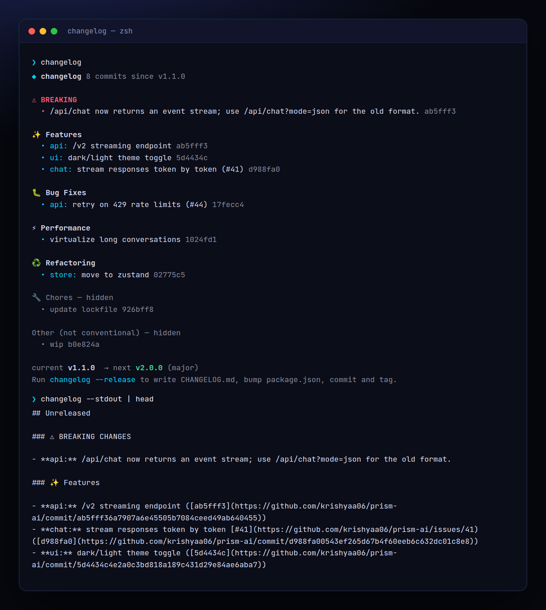

<!-- ═════════════ HEADER ═════════════ -->
<p align="center">
  
</p>

<p align="center">
  
</p>

<p align="center">
  <a href="https://github.com/krishyaa06/prism-changelog/actions/workflows/ci.yml"></a>
  
  
  <a href="LICENSE"></a>
</p>

<p align="center">
  
</p>


## ⚡ Overview

**Prism Changelog** (`changelog`) reads your git history, understands [Conventional Commits](https://www.conventionalcommits.org) (`feat:`, `fix(api):`, `feat!:`, `BREAKING CHANGE:`) and writes a tidy `CHANGELOG.md` with one section per tag. Sections are grouped by type and scope, with links to commits, issues and GitHub compare views. It also tells you what the next version should be, and `--release` does the whole dance: bump `package.json`, write the changelog, commit and tag.

## ✨ Features

- **Preview** unreleased changes grouped by type, with hidden chores/other commits summarised
- **Full CHANGELOG.md** with a section for every semver tag + Unreleased
- **Breaking changes** from `!` or `BREAKING CHANGE:` footers, shown first
- **Links** to commits, `#issues` and `compare/v1...v2` for GitHub & GitLab remotes
- **Semver suggestion**: breaking → major (minor on 0.x), feat → minor, else patch
- `--release [major|minor|patch|x.y.z]` bumps package.json, writes, commits `chore(release)` and tags
- `--types`, `--authors`, `--json`, `--stdout`; zero dependencies

## 🚀 Quick Start

```bash
# run without installing
npx github:krishyaa06/prism-changelog 

# or install globally
npm install -g github:krishyaa06/prism-changelog
changelog --release
```

Requires Node.js 18.17+. No dependencies.

## 🛠️ Usage

```text
changelog                     preview unreleased changes + suggested version
changelog --write             (re)generate CHANGELOG.md for all tags
changelog --release           bump version, write CHANGELOG, commit + tag
changelog --release minor     force the bump level (major | minor | patch | 1.4.0)

  -o, --out <file>      output file (default CHANGELOG.md)
      --types <list>    sections to include (default feat,fix,perf,refactor,docs,revert; "all")
      --authors         add commit authors
      --stdout          print the full changelog
      --json            unreleased commits + bump as JSON
      --no-commit       with --release: write files only
```

Try it on a demo repo: `sh examples/make-demo-repo.sh /tmp/demo && changelog --cwd /tmp/demo`.

After `--release`, push with `git push --follow-tags`.

## 📁 Project Structure

```text
prism-changelog/
├── assets/
│   ├── logo.png
│   └── logo.svg
├── bin/
│   └── changelog.js   # CLI entry
├── examples/
│   └── make-demo-repo.sh   # demo git history
├── src/
│   ├── index.js   # parser, grouping, markdown
│   └── ui.js   # colours, tables
├── test/
│   └── changelog.test.js
├── .gitignore
├── LICENSE
└── package.json
```

## 🧪 Tests

```bash
npm test
```

Tests use the built-in `node:test` runner, so there is nothing to install. CI runs them on Node 20 and 22.

## 🤝 Contributing

1. Fork the repo and create a branch: `git checkout -b feature/my-idea`
2. Make your change and add a test in `test/`
3. Run `npm test` and open a Pull Request

## 🔷 Part of Prism Protocol

Prism Changelog is one of the open-source tools built by [Prism Protocol](https://dc.gg/prismprotocol), a tech community where young builders learn, ship and compete together.

## 👤 Author

<table>
  <tr>
    <td align="center">
      <a href="https://github.com/krishyaa06"><br><b>Soumya Bhandare</b></a><br>
      <sub>Founder @ Prism Protocol</sub>
    </td>
    <td>
      <a href="https://dc.gg/prismprotocol"></a><br>
      <a href="https://instagram.com/prism_protocol_"></a><br>
      <a href="https://x.com/krishyaa06"></a>
    </td>
  </tr>
</table>

## 📄 License

Released under the [MIT License](LICENSE).

<p align="center">
  <b>If you like this project, consider giving it a ⭐</b><br>
  <sub>"Build. Create. Compete." · Made with ⚡ by Prism Protocol</sub>
</p>


